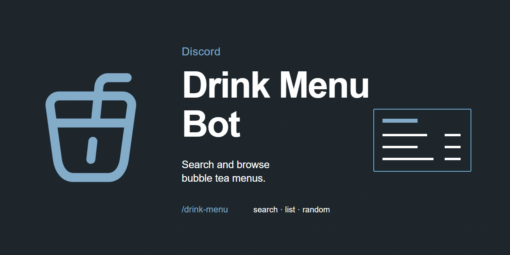

# Discord Drink Menu Bot



A Discord slash-command bot for searching and browsing bubble tea shop menus. It displays menu images from saved URLs and lets users manage entries through Discord interactions.

## Features

- Search shop names with a case-insensitive keyword of at least two characters.
- Browse the saved shop list or display a randomly selected menu.
- Let users add, edit, and delete menu image links through `/drink-menu settings`. Only user IDs listed in `ADMINISTRATION` can manage entries.
- View bot details with `/bot-info`.

## Requirements

- Node.js `18.4.0`
- npm `8.13.2`
- A Discord application and bot
- Discord user IDs for users allowed to manage menus

## Setup and Run

From the project root, install dependencies:

```bash
npm install
```

Create a `.env` file in the project root:

```dotenv
TOKEN=your-discord-bot-token
CLIENT_ID=your-discord-application-id
ADMINISTRATION=discord-user-id-1,discord-user-id-2
```

Replace the example values with your bot token, application ID, and comma-separated user IDs allowed to manage menu entries. The bot registers its slash commands for the application identified by `CLIENT_ID` when it starts.

Start the bot from the project root:

```bash
npm start
```

Invite the bot to a Discord server where you want to use its slash commands.

## Commands

| Command | Description |
| --- | --- |
| `/drink-menu search name:<shop>` | Search for a menu by shop name. The keyword must contain at least two characters. |
| `/drink-menu list` | Display the saved shop list. |
| `/drink-menu random` | Display a randomly selected menu. |
| `/drink-menu settings` | Open menu management controls. Only users listed in `ADMINISTRATION` can use them. |
| `/bot-info` | Display information about the bot. |

The settings controls let administrators add, edit, or delete menu entries. Menu entries use image URLs.

## Menu Data

Menu records are stored in `src/base/document/drink-menu.json`. Each record contains a shop name, a menu image URL, the user ID of the person who added or edited it, and a date. Changes made through the settings controls are written to this file.

## Repository Structure

```text
Discord Drink Menu Bot/
├── src/
│   ├── base/
│   │   ├── document/
│   │   │   └── drink-menu.json  # Menu records
│   │   └── functions/
│   │       └── json.js          # Menu data operations
│   ├── commands/                # Slash commands
│   ├── components/
│   │   ├── buttons/             # Menu management buttons
│   │   └── modals/              # Menu management forms
│   ├── events/client/           # Discord client events
│   ├── functions/handlers/      # Command, event, and component handlers
│   └── bot.js                   # Bot entry point
└── package.json

## License and Menu Images

The repository is licensed under the MIT License; see [LICENSE](LICENSE). Menu image URLs refer to third-party content. The rights to those images remain with their respective owners, and use is subject to the terms of the sites that host them.